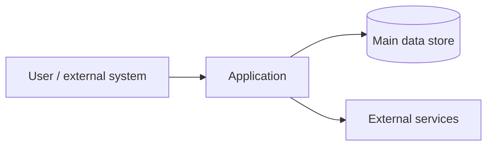

---
{"document":"architecture","status":"draft","owner":"<project-owner>","last_reviewed":"<YYYY-MM-DD>"}
---

# Architecture Overview

Fill in this page with the actual architecture. Accepted decisions and alternatives belong in `docs/decisions/`; do not turn an incidental implementation into intended architecture without evidence.

## Context
<Where the system sits and which external systems surround it.>

## High-level architecture

## Main components
| Component | Responsibility | Source of truth |
|---|---|---|
| ... | ... | ... |

## Main data flows
1. ...
2. ...

## Critical invariants
- ...

## Trust and access boundaries
- ...

## Known architectural debt
- ...

## Related decisions
- ...
