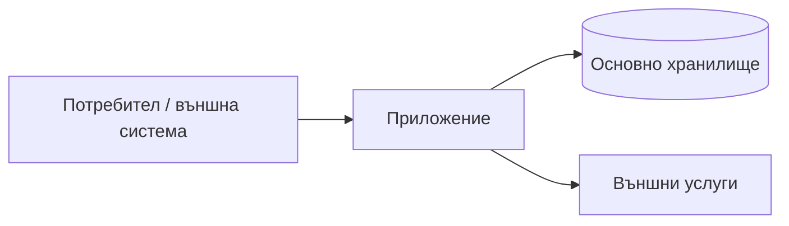

---
{"document":"architecture","status":"draft","owner":"<project-owner>","last_reviewed":"<YYYY-MM-DD>"}
---

# Архитектурен преглед

Попълнете тази страница с действащата архитектура. Приетите решения и алтернативи са в `docs/decisions/`; не превръщайте случайна реализация в намерена архитектура без доказателство.

## Контекст
<Къде се намира системата и кои външни системи я заобикалят.>

## Архитектура на високо ниво

## Основни компоненти
| Компонент | Отговорност | Източник на истина |
|---|---|---|
| ... | ... | ... |

## Основни потоци от данни
1. ...
2. ...

## Критични инварианти
- ...

## Граници на доверие и достъп
- ...

## Известен архитектурен дълг
- ...

## Свързани решения
- ...
