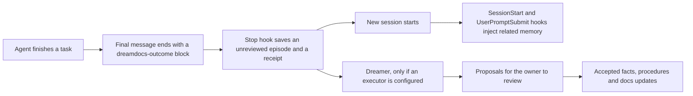

---
{"document":"how-it-works","status":"draft","owner":"<project-owner>","last_reviewed":null}
---

# How Dreamdocs works, end to end

Dreamdocs keeps two things apart. `docs/` holds knowledge the project owner has accepted.
`memory/` holds what happened and what was learned: episodes, proposed lessons and, after review,
facts and procedures. Nothing moves from memory into `docs/` or into an accepted fact without an
owner review ([promotion rules](../governance/promotion-rules.md)).

## The automatic memory loop

1. **Instruction block.** Setup adds a short block to the project's `AGENTS.md`. It tells the agent to
   end a meaningful task with one fenced `dreamdocs-outcome` JSON block: status, summary, optional
   lessons and evidence. The block is plain text in the chat. By itself it saves nothing.
2. **Capture.** The `Stop` hook reads the last block in the final message and writes it to
   `memory/episodes/` as an *unreviewed* episode, plus a receipt in `memory/automation/receipts/`.
   A turn without a block writes only a receipt. Content that looks like a credential is refused.
3. **Recall.** At the start of a session, and again for each prompt with enough meaningful words, the
   hooks add related memory to the agent's context. It is framed as untrusted data: the agent may
   use it as a lead and must check sources before acting on it.
4. **Curation (optional).** The Dreamer reads episodes and *proposes* facts, procedures and
   documentation updates. It runs only when you configure an executor, and on a schedule only when you
   opt in ([Dreamer setup](dreamer-setup.md), [execution](dreamer-execution.md)). It never accepts
   anything itself.
5. **Review.** The owner accepts, edits or rejects proposals. Only then does project truth change.

## What is automatic and what is not

| Step | Automatic once set up? | Condition |
|---|---|---|
| Saving an outcome as an episode | Yes | Hooks are trusted in the client and the agent emitted the block |
| Recalling memory in a new session | Yes | Same, and the memory contains something related |
| Dreamer curation | No | You configure an executor and, separately, a schedule |
| Accepting facts, procedures and docs changes | No | Always an owner decision |
| Updating Dreamdocs itself | No | Explicit pinned [upgrade](upgrading.md); hooks must be trusted again afterwards |

## Where things live

| Path | Purpose |
|---|---|
| `AGENTS.md` | Agent rules plus the outcome instruction block between the `dreamdocs:automation` markers |
| `.codex/hooks.json` | Project hooks for Codex; holds absolute paths for this computer and is Git-ignored by setup |
| `adapters/codex/hook.py` | The hook program (standard library Python only) |
| `memory/automation.json`, `memory/automation/install.json` | Project binding and the install manifest |
| `memory/automation/receipts/` | One receipt per handled turn; proof of capture, not of recall |
| `memory/episodes/` | Captured outcomes; files named `auto-evt-*` came from hooks |
| `.dreamdocs/` | Local, Git-ignored backups and private working data |

## Trust and safety

- Codex runs project hooks only after you review and trust them. A changed hook needs trust again,
  which includes every setup and upgrade. Never use `--dangerously-bypass-hook-trust`.
- The hooks never read transcripts, never call a model and never block the agent.
- Captured episodes and recalled text are data, not instructions.
- Setup never edits your user-level Codex configuration and never installs a schedule.

## How to tell that it really works

Configuration is not proof. `python -B scripts/dreamdocs.py doctor` reports capture, hook integrity,
trust and recall as separate findings, and each starts as unknown until observed. The reliable check
is behavioral: finish a real task, confirm a new `auto-evt-*` episode and receipt exist, then start a
new session and see the saved content recalled ([two-session demo](../../prompts/memory-demo.md)).

See also: [first run](first-run.md), [Codex adapter](agents/codex.md),
[automation contract](automation-contract.md), [memory health](memory-health.md).
